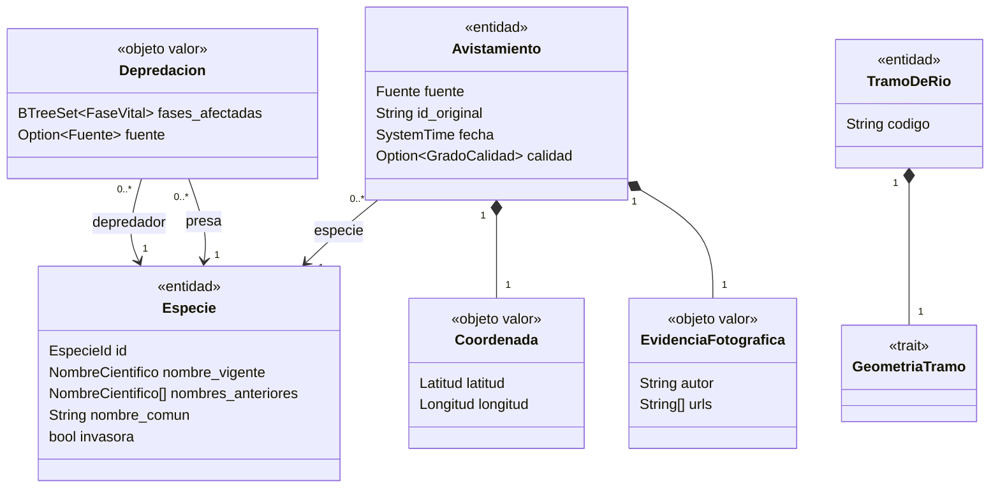

# Modelado del dominio (Milestone 0)

Este documento recoge el proceso seguido para obtener el modelo del dominio a partir de las [historias de usuario](../objetivo-1/historias-usuarios.md) y las [jornadas](../objetivo-1/user-journeys.md), tal como pide el [Milestone 0](../objetivo-1/milestones.md). El código está en [`src/dominio`](../../../src/dominio) y la prueba que construye el caso real en [`tests/caso_real.rs`](../../../tests/caso_real.rs).

## 1. Glosario

Términos extraídos de HU001, HU002 y las jornadas 1 y 2.

| Término | Significado | Origen |
|---|---|---|
| Especie | Ser vivo identificado por su nombre científico. Su nombre puede cambiar con la taxonomía sin dejar de ser la misma especie. | HU001, HU002 |
| Especie objetivo | Especie que el pescador quiere capturar (ej. cangrejo). Es un papel, no un tipo de especie. | HU001, Jornada 1 |
| Especie invasora depredadora | Especie invasora que se come o desplaza a la especie objetivo (ej. visón americano). | HU001, HU002 |
| Depredación | Relación entre un depredador y una presa, en unas fases vitales concretas de la presa. | HU001 |
| Fase vital | Etapa de la vida de la presa: huevo/embrión, larva/alevín, juvenil o adulto. | HU001 |
| Zona / tramo de río | Parte de un río donde se pesca o se estudia la especie. | HU001, HU002 |
| Avistamiento | Observación de una especie en un lugar y una fecha, aportada por alguien a una fuente. | HU001, HU002 |
| Fuente | Plataforma de la que procede el avistamiento (iNaturalist o GBIF). | HU001, HU002 |
| Identificador original | Identificador del avistamiento en su fuente. | HU001 |
| Coordenada | Latitud y longitud del avistamiento. | HU001 |
| Grado de calidad | Nivel de confirmación de la identificación que da iNaturalist. | Caso real |
| Evidencia fotográfica | Fotos del avistamiento y su autor. | Caso real |
| Ventana temporal | Periodo en el que los avistamientos cuentan como recientes (ej. 15 días). | HU001 |
| Serie temporal | Avistamientos de una especie en una zona ordenados en el tiempo. | HU002 |
| Primer / último avistamiento | Extremos de la serie temporal en una zona. | HU002 |
| Estado de presencia | Resultado de la consulta: «presencia detectada» o «sin registros recientes». | HU001 |

## 2. Caso real anotado

Observación [395192703 de iNaturalist](https://www.inaturalist.org/observations/395192703), obtenida de su API (`/v1/observations/395192703`). Se marcan en **negrita** los sustantivos (candidatos a conceptos) y en *cursiva* los verbos (candidatos a eventos):

> **Marco C** *observó* un **visón americano** (**Neogale vison**, antes **Neovison vison**) el **28/08/2026 a las 10:44** (+02:00) en la **coordenada** 40.0400030897, -4.6470027317 (Lucillos, Toledo). Lo *registró* en **iNaturalist** con el **identificador** 395192703 y *adjuntó* 6 **fotos** con licencia CC BY-NC. La comunidad *confirmó* la identificación, por lo que tiene **grado de calidad** `research`.

Campos de la API y qué se hace con cada uno:

| Campo de la API | Valor | En el modelo | Motivo |
|---|---|---|---|
| `id` | 395192703 | `Avistamiento::id_original` | HU001: identificador de la observación original |
| (origen de la consulta) | iNaturalist | `Fuente::INaturalist` | HU001: fuente |
| `taxon.name` | Neogale vison | `Especie::nombre_vigente` | HU001: especie |
| (taxonomía previa) | Neovison vison | `Especie::nombres_anteriores` | Los avistamientos antiguos usan el nombre anterior (HU002) |
| `taxon.preferred_common_name` | American Mink | `Especie::nombre_comun` («visón americano») | Antonio busca por nombre común (Jornada 1) |
| `time_observed_at` | 2026-08-28T10:44:30+02:00 | `Avistamiento::fecha` | HU001: ventana temporal; HU002: primer y último avistamiento |
| `location` | 40.0400030897,-4.6470027317 | `Avistamiento::coordenada` | HU001: latitud y longitud, para saber en qué tramo cae |
| `quality_grade` | research | `GradoCalidad::Investigacion` | Distinguir avistamientos confirmados de los dudosos |
| `user.name` | Marco C | `EvidenciaFotografica::autor` | Atribución de las fotos (licencia CC BY-NC) |
| `photos[].url` | 6 URLs | `EvidenciaFotografica::urls` | Comprobar que la especie está bien identificada |
| `place_guess` | Lucillos, Toledo, ES | No se guarda | Texto libre; el tramo se obtiene de la coordenada |
| `description`, `comments`, etc. | — | No se guardan | Ninguna HU los necesita |

## 3. Eventos por historia de usuario

| HU | Evento | Qué lo provoca |
|---|---|---|
| HU001, HU002 | Avistamiento registrado | Alguien sube una observación a iNaturalist o GBIF. |
| HU001, HU002 | Identificación confirmada | La comunidad de iNaturalist confirma la especie (cambia el grado de calidad). |
| HU001, HU002 | Especie renombrada | La taxonomía cambia el nombre científico (Neovison vison → Neogale vison). |
| HU001 | Zona consultada | Antonio consulta un tramo y una especie objetivo antes de salir. |
| HU001 | Presencia detectada / sin registros recientes | Resultado de la consulta según haya o no avistamientos del depredador en la ventana temporal. |
| HU002 | Especie aparecida en una zona | Primer avistamiento de la especie en un río. |
| HU002 | Especie desaparecida de una zona | Pasa el tiempo sin avistamientos después del último. |

En el Milestone 0 los eventos no se programan: sirven para ver qué datos tienen que existir. Por ejemplo, «especie renombrada» obliga a que la identidad de la especie no sea su nombre, y «especie aparecida/desaparecida» obliga a guardar la fecha de cada avistamiento.

## 4. Traducción a código

| Concepto | Tipo | Fichero | HU | Issue |
|---|---|---|---|---|
| Especie | `Especie`, `EspecieId`, `NombreCientifico` | [`especie.rs`](../../../src/dominio/especie.rs) | HU001, HU002 | #10 |
| Depredación, fase vital | `Depredacion`, `FaseVital` | [`depredacion.rs`](../../../src/dominio/depredacion.rs) | HU001 | #11 |
| Zona / tramo de río | `TramoDeRio`, `GeometriaTramo` | [`tramo.rs`](../../../src/dominio/tramo.rs) | HU001, HU002 | #12 |
| Avistamiento, fuente, calidad, fotos | `Avistamiento`, `Fuente`, `GradoCalidad`, `EvidenciaFotografica` | [`avistamiento.rs`](../../../src/dominio/avistamiento.rs) | HU001, HU002 | #13 |
| Coordenada | `Coordenada`, `Latitud`, `Longitud`, `HemisferioNS`, `HemisferioEW` | [`coordenada.rs`](../../../src/dominio/coordenada.rs) | HU001 | #12 |
| Estado de presencia | `EstadoPresencia` | [`presencia.rs`](../../../src/dominio/presencia.rs) | HU001 | #14 |
| Restricciones del dominio | `ErrorDominio` | [`error.rs`](../../../src/dominio/error.rs) | HU001, HU002 | #17, #18 |

Quedan fuera del Milestone 0, porque son lógica de negocio: la ventana temporal y el cálculo del estado de presencia (HU001), y la serie temporal con el primer y el último avistamiento (HU002).

## 5. Clasificación: entidades y objetos valor

Criterio aplicado: **entidad** si tiene identidad propia que se mantiene aunque cambien sus atributos (ciclo de vida); **objeto valor** si se define solo por sus atributos y es inmutable.

| Concepto | Clasificación | Justificación |
|---|---|---|
| `Especie` | Entidad | Su nombre científico puede cambiar (Neovison vison → Neogale vison) y sigue siendo la misma especie. Se identifica por `EspecieId`. Es la entidad indicada en `iv.yaml`. |
| `Avistamiento` | Entidad | Se identifica por fuente + identificador original. Si la fuente corrige un dato (por ejemplo, sube el grado de calidad), sigue siendo el mismo avistamiento, y recibir la misma observación dos veces no debe contarla doble en la ventana temporal. |
| `TramoDeRio` | Entidad | Se identifica por su código. Su geometría puede refinarse sin que deje de ser el mismo tramo. |
| `Depredacion` | Objeto valor | No tiene identidad: dos relaciones con el mismo depredador, presa y fases son la misma. La fuente no forma parte de la igualdad. |
| `Coordenada` | Objeto valor | Dos puntos con la misma latitud y longitud son el mismo punto. |
| `Latitud`, `Longitud` | Objeto valor | Un solo atributo, justificado: garantizan el rango válido al construirse y, al ser tipos distintos, intercambiarlas no compila. |
| `NombreCientifico` | Objeto valor | Un solo atributo, justificado: garantiza el formato binomial al construirse. |
| `EspecieId` | Objeto valor | Un solo atributo, justificado: es la identidad de `Especie`, estable aunque cambie el nombre. |
| `EvidenciaFotografica` | Objeto valor | Se define por su autor y sus URLs. |
| `Fuente`, `GradoCalidad`, `FaseVital`, `EstadoPresencia`, hemisferios | Objeto valor (enum) | Conjuntos cerrados de valores. |

## 6. Relaciones y cardinalidades

- Un avistamiento es de exactamente una especie; una especie puede tener muchos avistamientos.
- Una depredación une exactamente un depredador y una presa, que no pueden ser la misma especie, y afecta al menos a una fase vital.
- El avistamiento no guarda el tramo: en qué tramo cae una coordenada se calcula con la geometría del tramo, y eso es lógica de negocio.
- Las referencias entre entidades se hacen por `EspecieId`, no guardando la `Especie` dentro, para que un cambio de nombre no obligue a tocar los avistamientos.

## 7. Decisiones de modelado

| Decisión | Alternativas descartadas | Motivo | HU |
|---|---|---|---|
| Lenguaje Rust | Java (propuesta inicial) | Sin `null`, `Result` para los errores del dominio y `enum` con datos; Java se descartó tras la indicación del profesor de que daría problemas en los siguientes objetivos. | Todas |
| Identidad de `Especie` por `EspecieId` | El nombre científico como identidad | El nombre cambia con la taxonomía (Neovison vison → Neogale vison) y los avistamientos antiguos usan el anterior; con el nombre como identidad se perderían en la serie temporal. | HU002 |
| Nombre común obligatorio | Nombre común opcional | Antonio busca «cangrejo», no el nombre científico. | HU001 |
| Especie objetivo y depredadora como papel dado por `Depredacion` | Un campo «es objetivo» / «es depredadora» en `Especie` | Una misma especie puede ser presa en una relación y depredadora en otra. | HU001 |
| Fecha con `std::time::SystemTime` | Un tipo `Fecha` propio; una biblioteca de fechas | Sin gestor de dependencias en el M0 y sin necesidad de calendario: basta con ordenar y restar instantes. Se revisará al añadir dependencias. | HU001, HU002 |
| Fuente obligatoria en `Avistamiento` y opcional en `Depredacion` | Obligatoria u opcional en las dos | Sin fuente no se puede identificar ni deduplicar un avistamiento; las relaciones de depredación pueden venir de catálogos internos sin fuente. | HU001 |
| Fases afectadas como conjunto, «todas» = las cuatro | Una variante `Todas` en `FaseVital` | Con `Todas` habría dos formas de decir lo mismo y comparar relaciones fallaría. | HU001 |
| Geometría del tramo como trait | Una lista de coordenadas; un polígono concreto | No se sabe aún de qué fuente saldrán los tramos; no acoplar el dominio a una representación. | HU001, HU002 |
| Hemisferio en el signo de la latitud/longitud, con `con_hemisferio` para N/S/E/O | Un campo hemisferio aparte | Un campo aparte permite estados contradictorios (latitud negativa con hemisferio norte). Las APIs devuelven grados con signo. | HU001 |
| `Latitud` y `Longitud` como tipos distintos | Dos `f64` | Intercambiarlas no compila. | HU001 |
| Grado de calidad como `enum` opcional | Un `String` con el valor de la API; no guardarlo | Solo hay tres valores posibles; es opcional porque GBIF no lo da. | HU001 |
| Identificador original y código de tramo recortados | Guardarlos tal cual | Forman parte de la identidad: «123» y «123 » deben ser el mismo. | HU001 |
| Autor «Anónimo» si no se conoce | Autor opcional | Las fotos siempre se atribuyen a alguien. | — |
| Estado de presencia como `enum` | Un booleano «hay depredador» | Que no haya avistamientos no significa que no haya depredador. | HU001 |

## 8. Prueba del caso real

[`tests/caso_real.rs`](../../../tests/caso_real.rs) construye con el modelo la observación del apartado 2 y comprueba que:

- el avistamiento conserva especie, fecha, latitud, longitud, fuente e identificador original (los campos que piden HU001 y HU002), además del grado de calidad y las fotos;
- la especie se puede reconocer tanto por su nombre vigente como por el anterior;
- la misma observación recibida dos veces (con espacios en el identificador) es un solo avistamiento;
- se puede construir la depredación del visón sobre la especie objetivo de Antonio.

Se ejecuta con:

    cargo test
